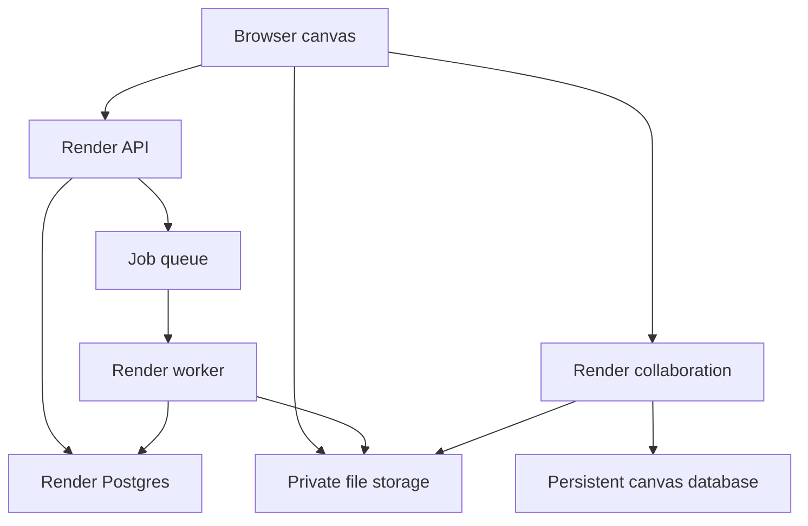

# Miro-style idea collaboration app: research and build plan

Prepared for Chase Boyajian · September 26, 2026

**Recommendation:** Build a focused creative collaboration product using React, TypeScript, a licensed tldraw canvas, its native synchronization library, and Render. Use private object storage for files and a background worker for previews. Establish the canvas license cost before committing to that engine. Develop the application in small, demonstrable milestones with Cursor.

The valuable outcome is a dependable shared workspace for ideas, references, feedback, and decisions. A usable version is achievable. Matching Miro's entire product, integrations, enterprise administration, mobile experience, and operational maturity is a much larger undertaking.

**Solo AI build target:** 48–72 hours for a working demo, 7–14 calendar days for an internal pilot, and 4–6 weeks for the broader release. Plan on $250–600 of cumulative Opus 5.5 Medium coding usage for the pilot, or $750–1,500 for the broader build, before applicable Cursor credits. These are aggressive planning targets under the assumptions in section 12, not measured delivery guarantees. Running the app is a separate $150–400/month allowance, plus the canvas license and Cursor.

## 1. Scope and assumptions

This plan assumes an internal creative team first, with invited clients or collaborators. It does not assume a public subscription business. Start with 10–30 registered users, a target of 20 simultaneous editors on a board, and typical boards containing hundreds to a few thousand objects. These are planning and test targets, not measured capacity.

Desktop browsers are the primary authoring environment. Tablet viewing and basic editing matter; phone viewing, commenting, and uploads come before a complete phone editor. Design workspace boundaries from the start so another team can be added without mixing its data.

Suggested workflows for DBC and similar creative teams: campaign ideation, reference and mood boards, trailer beats, storyboards, pitch development, review sessions, and production planning. These are recommendations, not assumptions about an existing system.

**Research basis:** Current Miro help articles, product and pricing pages, individual reviews on TrustRadius and Product Hunt, and official technical documentation. This is a researched understanding of Miro's workflows; paid workspace features were not hands-on tested in this session. Public reviews provide directional evidence, not a representative survey or a statistically ranked feature list. Some TrustRadius reviews are marked incentivized. Vendor documentation establishes capabilities, not independent proof of quality.

## 2. How Miro's core workflows fit together

Miro is more than a drawing surface. Its canvas combines free placement with structure, shared participation, asynchronous review, and presentation.

| Workflow | What people do in Miro | Requirement for this product |
|---|---|---|
| Prepare a session | Start from a template; arrange named frames; add reference material | A useful template must create editable objects, with clear entry and navigation points |
| Collect ideas | Create notes rapidly, paste spreadsheet cells into notes, add images and links | Bulk entry, paste, drag and drop, keyboard shortcuts, and fast duplicate actions |
| Make sense of ideas | Move, group, connect, label, and arrange material | Reliable selection, snapping, alignment, bound connectors, and simple clustering |
| Work together | See other participants, their cursors, selections, and changes | Synchronization, presence, permissions, reconnection, and clear saving status |
| Facilitate | Use timers, voting, follow, and attention management | Shared session state controlled by the server; easy escape from following |
| Review later | Comment on content, mention people, find changes | Durable threads, object links, notifications, and history |
| Present and share | Walk through frames and export a deliverable | Ordered frames, present mode, review links, and portable exports |

Miro's frames serve as named regions and support presentation. Its attention tools let participants follow someone or gather at the presenter's location. Its current interface separates creation tools, navigation, collaboration, and presentation. These are useful product patterns to study, while giving this app its own visual design. [1–3]

Two details affect implementation. Miro can turn pasted spreadsheet cells into sticky notes, which makes bulk idea entry practical. Its voting tool has a defined voting area, a per-person allowance, a duration, and a results phase. Those behaviors require more than drawing vote counters onto a canvas. [4–5]

Miro also documents private brainstorming, board version recovery, mind maps, and multiple export options. Private mode is explicitly described as not being a data protection feature. A true confidential-draft feature in this app should use server-side access separation. [6–9]

## 3. What users value, and the implications

These priorities synthesize recurring themes in the reviews inspected. They are a product recommendation, not a measured market ranking. [10–11]

| Priority | Recurring value | Build implication |
|---|---|---|
| 1 | Working on the same board at the same time | Live changes must feel immediate and survive disconnects |
| 2 | Seeing ideas and relationships in one place | Canvas navigation and organization are essential |
| 3 | Starting quickly with templates | Ship a small set of useful editable templates |
| 4 | Combining references with ideas | Uploads, previews, links, and comments belong in the normal editing flow |
| 5 | Explaining workflows visually | Good connectors, labels, and diagram tools matter |
| 6 | Sharing work and returning to it later | Review access, persistent threads, and board discovery matter |

Individual reviewers also describe board clutter, navigation difficulties, and slowdowns on large boards. Turn those complaints into requirements: an outline of frames, a minimap, search with jump-to-result, lightweight previews, and measured performance on image-heavy boards. Keep advanced tools discoverable without crowding the default toolbar.

## 4. Feature scope

The first release should be useful during real creative work. The broader release should cover the main whiteboarding and facilitation features the user asked for.

| Area | Dependable first release | Broader release | Defer until demand is demonstrated |
|---|---|---|---|
| Canvas | Pan/zoom, notes, text, shapes, pen, arrows, images, selection, groups, ordering, snapping, undo/redo | Mind maps with automatic layout, richer diagram tools | Specialized engineering shape catalogs |
| Structure | Named frames, frame outline, board search, basic tags | Layers UI, richer search, tables and Kanban cards | Spreadsheet-grade formulas and dependency planning |
| Collaboration | Live cursors and selections, concurrent editing, reconnect, saved-state feedback | Follow presenter, gather participants, reactions, session timer | Hundreds of participants per board |
| Access | Sign-in, workspace membership, board invitations, owner/editor/commenter/viewer roles | Expiring review links, signed-in guests, optional named visitor sessions | Enterprise SSO/SCIM and complex policy administration |
| Files | Images, PDF previews/page extraction, playable supported MP4, basic audio, attachment cards, original downloads | Office previews, HEIC conversion, more video formats, Drive import | Native editing of Adobe, Office, or 3D project files |
| Feedback | Anchored threads, resolve/reopen, mentions, notifications | PDF-page anchors, video timestamps, review status | Frame.io-level media review and version comparison |
| Templates | Brainstorm, mood board, storyboard, pitch, retro, simple planning board | Save selection/board as template; shared template library | Public template marketplace |
| Workshops | Basic frame presentation | Voting, timer, private-draft reveal, presenter controls | Breakout orchestration and built-in video conferencing |
| History/export | Recoverable deletion, named snapshots, restore as new board, PNG/PDF and native board export | Scheduled history browser, CSV exports, asset-complete portable packages | Pixel-perfect Miro import of every object type |
| AI | Keep core flows independent of AI | Summaries, grouping suggestions, brief-to-board, transcript-to-notes | Unsupervised edits or complex agent workflows |

Accessibility belongs across these releases: keyboard access to controls, readable focus states, labeled buttons, sufficient contrast, reduced motion, and a text/list view of board content. A large visual canvas alone is insufficient for accessible review.

## 5. Canvas and collaboration engine decision

| Approach | Benefit | Tradeoff | Recommendation |
|---|---|---|---|
| tldraw + native tldraw sync | Mature canvas behavior and a matching synchronization system; custom shapes | Production licensing and responsibility for the backend | Preferred, subject to an acceptable quote and prototype results |
| tldraw + Liveblocks | Managed collaboration infrastructure with an official integration guide | Additional vendor cost; adapter/version compatibility; separate tldraw license | Good alternative if minimizing server operations is more important |
| Excalidraw foundation | MIT-licensed editor and strong sketching experience | Embedded editor is not the complete hosted collaboration product; more custom work for this media-heavy scope | First alternative if tldraw economics do not fit |
| Custom canvas engine | Maximum control over appearance and data model | Selection, text, binding, undo, gestures, rendering, and sync all become our responsibility | Avoid for the first product |

tldraw's production SDK is not permissively licensed. Its published pricing uses a commercial quote, with trial and discretionary hobby options. Do not assume an internal business tool or nonprofit project qualifies for a hobby license. Obtain terms covering this exact use, production domains, ongoing costs, and upgrades. Its commenting package also requires a license that includes commenting. [12–13, 17]

The plan below uses an independently implemented comment system in Postgres. If the licensed commenting module is attractive, switch deliberately and document where its data lives; do not maintain two authoritative copies of the same threads.

Excalidraw's repository distinguishes the editor package from the collaboration and storage features of its hosted application. Budget for building or integrating those services. Liveblocks publishes a tldraw integration using a storage adapter; treat it as an alternative synchronization architecture, not a second layer added on top of native sync. [18–19]

## 6. Recommended architecture

**Use React + Vite + TypeScript for the browser and Node.js + Fastify for the API.** A canvas application does not need server rendering to be useful. Keeping the browser static makes the Render deployment straightforward. Use a pnpm workspace, shared validation schemas, and a pinned dependency lockfile.

| Component | Responsibility | Location |
|---|---|---|
| Browser application | Dashboard, canvas, comments UI, previews, presentation | Render Static Site |
| API service | Permissions, workspace/board metadata, signed uploads, comments, integrations, AI requests | Paid Render Web Service |
| Collaboration service | One live room per board, authoritative canvas state, presence | Paid Render Web Service, one instance initially |
| Canvas persistence | SQLite files under the persistent mount; one database per board initially | Persistent disk attached to the collaboration service |
| Application database | Users, memberships, ACLs, assets, comments, jobs, snapshot index | Render Postgres |
| Job queue/event transport | Conversion jobs, retry scheduling, permission-change signals | Render Key Value + BullMQ |
| Processing worker | Thumbnails, PDF pages, media probes/proxies, exports | Render Background Worker using a Docker image |
| File storage | Originals, preview derivatives, exports, consistent backup files | Private Cloudflare R2 bucket, or S3 equivalent |
| Sign-in | Google/email authentication, session tokens | Clerk initially |

Clerk supplies identity; application tables and server checks still determine who may access each workspace, board, and file. Validate session tokens using supported backend SDKs. Do not trust a user ID or role supplied by the browser. [20]

The browser-to-storage connection uses short-lived authorized URLs. The collaboration-to-storage connection is for backups; normal binary uploads do not travel over the board WebSocket.

**Data ownership:** canvas records live in the synchronization store; relational application state lives in Postgres; file bytes live in object storage. Search indexes and thumbnails are derived data. Do not let a generic board-update API replace the whole canvas JSON on every save.

tldraw supports a JavaScript/WebSocket backend and documents SQLite-backed persistence. It requires only one authoritative room instance per document. We are choosing that supported route for Render, with a deliberately bounded first deployment. [14–16]

### Render constraints to incorporate

Render supports WebSockets. Its load balancer can put new or reconnecting connections on different instances. A persistent disk is available to only one instance, prevents horizontal scaling of that service, and prevents zero-downtime deployments. Files outside its mount are ephemeral. [21–22]

For this release, run one collaboration process with a room registry and persistent storage. Place SQLite databases under `/var/data/rooms`. Use validated generated board IDs for filenames. Evict idle room objects safely after committed writes, without deleting their persistent data. Do not enable clustering or autoscaling on this service.

Expect a short collaboration interruption during deployment. Show reconnecting state, preserve pending local work through the supported client behavior, and verify resynchronization. Schedule production updates outside workshops. API and worker services can evolve independently.

For scale, choose one explicit next architecture: partition rooms across owners with a durable routing/fencing design, or move collaboration to the official Cloudflare Durable Objects template while the app/API remain on Render. Managed Liveblocks is a separate alternative. Redis broadcasting alone does not solve two authoritative tldraw rooms editing the same board.

## 7. Reliable shared editing

Use the canvas SDK's synchronization and undo mechanisms. Do not invent a competing whole-board save loop, combine native sync with Yjs for the same records, or make browser local storage the only durable copy.

Required behavior:

1. User signs in; API verifies board access and issues a short-lived, board-specific connection ticket.
2. Collaboration service validates that ticket, the allowed origin, current permission, and board status before joining the room. Redact tickets from logs.
3. Changes pass through schema and permission validation. Viewers/commenters cannot mutate canvas records even with forged requests.
4. Presence is temporary. Cursors and selections are not appended to durable history as board edits.
5. The UI distinguishes connecting, connected, unsynced/reconnecting, and error states. A saved indicator must correspond to verified persistence semantics, not merely a sent message.
6. Permission changes invalidate active access through a server event plus periodic checks. Target enforcement within 15 seconds, with the bound tested. Existing downloaded bytes cannot be revoked.
7. A reconnect reconciles with the authoritative room. It never blindly uploads an older complete snapshot over the board.

**Concurrent typing needs an explicit prototype test.** A synchronized canvas does not automatically guarantee Google Docs-style character merging inside every custom text field. Test two people editing the same note, a delete while another person types, and undo after a remote change. If native behavior cannot meet the agreed requirement, use a server-enforced short text-edit lease with visible editor identity and expiry recovery for version one. Treat character-level collaborative rich text as a separate enhancement.

For permanent data, verify the chosen SQLite durability settings and that acknowledged changes survive a killed process. Keep documented recovery objectives: no lost committed changes on an ordinary process restart; a provisional disaster-recovery target of at most 15 minutes of lost changes and restoration within four hours. These are release targets to prove, not guarantees from Render.

Create SQLite-consistent backups with a database backup API, upload them to private storage, and retain a manifest and checksums. Do not copy only the main file of a live WAL-mode database. Use application-level backups and restore drills, not only infrastructure disk snapshots. Keep Postgres backups and canvas backups coordinated enough to resolve board IDs and asset references.

## 8. File support: upload, preview, and editing

Miro supports a broad list of image, document, spreadsheet, presentation, and video formats. Its dedicated video article lists MP4, MOV, and WebM and a 150 MB upload limit. The generic formats page and dedicated video page disagree on plan availability; use the dedicated article as the stronger feature-specific source and verify plan entitlements in an actual account before relying on them. [23–24]

Miro also supports extracting pages from PDFs and presentations onto the board. Uploaded PDF content is a snapshot rather than an automatically updated source document. These distinctions matter for our own UI. [23, 25]

**Our proposed contract:** retain the original; generate safe visual previews where supported; allow annotation; preserve a download path. A preview is not a native file editor.

| Type | First behavior | Implementation and limitation |
|---|---|---|
| JPG, PNG, WebP, GIF | Place on canvas, resize, crop, annotate | Sharp for static derivatives; preserve the original and supported animation |
| SVG | Preview as a safe raster image initially | Isolated rasterization; never insert an untrusted SVG directly into the app DOM |
| PDF | Cover preview, page viewer, extract selected pages onto canvas | PDF.js or worker-rendered page images; lazy page loading; retain original page numbering |
| MP4 | Poster and click-to-play | Begin with tested browser-compatible H.264/AAC; probe codecs rather than trusting extension |
| MOV, WebM, unusual codecs | Upload with processing status, then playable proxy | Worker conversion to a supported proxy, or a managed media API; release after format tests |
| MP3, WAV, M4A | Audio card and playback | Preserve original; generate a browser-compatible proxy when needed |
| DOCX, PPTX, XLSX | Attachment initially; visual preview in the broader release | CloudConvert initially or isolated LibreOffice conversion; font/layout fidelity requires fixtures |
| CSV/TSV, TXT/Markdown | Text/table preview; import lines/cells as notes | Row/page limits; sanitize markup; neutralize spreadsheet formulas on exports |
| HEIC/HEIF, TIFF, BMP | Convert to a display image | Verify actual decoder support and memory bounds in the worker image |
| PSD, AI, EPS | Original attachment plus supplied preview | Best-effort flattened conversion later; no layer or vector editing promise |
| ZIP, AEP, PRPROJ, BLEND and other allowed project files | Attachment card with metadata and download | No native preview promise; no automatic archive expansion or execution |
| Google Docs/Slides/Sheets | Link card first; explicit Drive import later | Import a dated snapshot or open the original in Google; not automatic two-way editing |
| Web URLs and supported embeds | Title/image card, approved embeds | Safe server-side unfurling and allowlisted iframe providers |

Proposed initial limits: images 25 MB, PDFs/Office documents 100 MB, audio/video 500 MB, other allowed attachments 250 MB. These are our proposed product limits, not Miro limits or measured worker capacity. Set page-count, pixel-count, duration, workspace-storage, and processing-cost limits too. Validate the limits with representative assets before opening them to everyone. Long or 4K source media should use a proxy or an external link initially.

The upload flow is: authorize and reserve quota; create an asset/version record; return a scoped upload URL; upload directly; verify object size and type; scan; queue a conversion; write derivatives; mark ready; notify viewers. Every stage has progress, retry, and failure states. Keep binary bytes out of Postgres rows and canvas records.

Jobs must be idempotent by asset version and conversion profile. Duplicate completion calls or worker retries must not duplicate assets or billable conversion requests. Handle a crashed worker, missing object, cancelled upload, timeout, exhausted quota, and expired URL. Use a sweeper to remove abandoned uploads after a grace period.

Keep assets immutable by version. A replacement upload gets a new version so comments remain anchored to the version actually reviewed. Shared use of an asset across boards must not accidentally expose it to a new workspace. Recheck access when generating a download URL; choose a short TTL and refresh it during playback when needed.

## 9. Comments, workshops, templates, and export

**Comments:** store threads and comments in Postgres. A thread can target a board position, a shape ID plus local coordinates, or an asset version/page/time. Moving an image should move its attached comment pin. Deleting an object should preserve the discussion as an orphaned or archived thread until the user resolves it. Notifications point to the correct object or time. Broadcast comment events only after database commits; reconnecting clients refetch authoritative thread state.

**Roles:** owners manage access; editors modify content; commenters add feedback; viewers read. Guests receive board-specific grants. Link access is opt-in with scope, expiry, and revocation. Public editing is not the default. A display name does not prove identity, and anonymous visitors should not be used where verified one-person-one-vote matters.

**Workshops:** timers use server start/end timestamps; voting uses transactional vote budgets and unique participants; participants do not receive other people's ballots before reveal. End/reveal actions must be idempotent. Let participants stop following a presenter. For private brainstorming, keep drafts in a private server namespace and reveal them into the board in a controlled operation. Do not hide already-broadcast text with CSS and call it confidential.

**Templates:** use editable schema-versioned records and regenerate object IDs, connector bindings, and internal references on insertion. Start with six templates built for this audience. Do not copy proprietary community templates or the Miro interface assets. Template duplication excludes invitations and active workshop sessions by default.

**Exports:** use bounds/frame-based PNG and PDF output. Large exports run as background jobs with font and image readiness checks. Video/audio use a poster plus an authorized link or attachment reference; a PDF does not retain interactivity. CSV contains readable text and IDs. Native exports include versioned board data and an asset manifest; an asset-complete ZIP becomes the portable archive. Import rewrites IDs and verifies checksums. Never treat an untested JSON dump as a complete backup.

**History:** create manual named checkpoints and periodic snapshots. Restore to a new private board first, with no inherited public links, and clearly report what happened to comments and review state. Retain assets while any active board or retained snapshot references them; deleting a shape is not permission to immediately delete its original file.

## 10. Useful APIs

| Service | Useful feature | Recommended timing |
|---|---|---|
| OpenAI Responses API | Group selected notes, suggest titles, summarize a frame, draft a board from a brief | After core collaboration and permission tests |
| OpenAI transcription | Convert an uploaded recording into transcript-linked notes | After stable audio/video processing |
| OpenAI image generation | Optional reference imagery or concept exploration | Later, with explicit user action and a spend limit |
| Google Picker + Drive API | Select particular Drive files and import them | Broader release |
| CloudConvert | Office and specialist-format preview conversions | Broader release, with a provider abstraction |
| Clerk | Managed sign-in and session verification | Foundation |
| Resend or equivalent | Invitations and mention notifications | Review milestone |
| Sentry or equivalent | Client/server failures and tracing | Foundation |
| Mux or a comparable media provider | Larger video workloads and adaptive playback | When measured media demand justifies it |

OpenAI Structured Outputs can return schema-constrained results; transcription and image generation have separate documented capabilities. Use configuration for the selected supported model instead of baking an assumed model name into business logic. API usage has a separate budget from a ChatGPT subscription. No AI API is necessary to synchronize users. [26–28]

For AI edits, send only the selected authorized context. Return proposed operations such as `createNote`, `createFrame`, `addConnector`, or `suggestGroups`. Show a preview and let the user apply it. Validate object IDs, bounds, counts, and permissions server-side; record the resulting operation so it can be reversed. Refusals, malformed output, stale board versions, and timeouts are normal failure cases. Treat text in imported documents as data, not permission to call tools or share files. Use a new frame for generated ideas unless the user asks to replace content.

For Google, use Picker with `drive.file` access to user-selected files. Explain whether the operation imports a board-visible copy or links to a Google-controlled original. A signed-in user's ability to read a Drive file is not blanket permission to grant every board participant access to the original. Implement explicit import semantics, source attribution, a refresh action, and clear failure when OAuth expires. Google documents and stored binary files use different download/export paths; export limits need handling. [29–31]

CloudConvert exposes conversion jobs and tasks. Keep conversion credentials in the worker/server, validate callback authenticity according to current provider documentation, and match callbacks to an existing job. Office fidelity should be assessed against real decks and fonts before claiming full support. [32]

## 11. Data model and project organization

Proposed application tables:

| Tables | Purpose |
|---|---|
| `users`, `workspaces`, `workspace_members` | Identity mapping and tenant boundaries |
| `projects`, `boards`, `board_members` | Organization, board ownership, explicit grants |
| `share_links`, `invitations` | Hashed tokens, roles, expiration, revocation |
| `assets`, `asset_versions`, `asset_derivatives`, `board_assets` | Original files, previews, association and access |
| `comment_threads`, `comments`, `mentions` | Review discussions with stable anchors |
| `templates`, `board_snapshots` | Reusable content, recovery metadata and file references |
| `workshop_sessions`, `votes`, `private_drafts` | Server-controlled workshop behavior |
| `jobs`, `outbox_events`, `ai_runs` | Durable job status, notifications, provider usage |
| `audit_events` | Sharing, deletion, restoration, integration and administrative actions |

All applicable rows carry workspace identity. Use database constraints and transactions for uniqueness, invitation redemption, quota reservation, and vote budgets. The authoritative canvas schema remains in the sync store. Custom shape types and their migrations are shared between client and server.

Suggested repository layout:

| Path | Responsibility |
|---|---|
| `apps/web` | React application |
| `apps/api` | Fastify HTTP API |
| `apps/sync` | Native tldraw WebSocket rooms |
| `apps/worker` | File processing, exports, AI tasks |
| `packages/canvas-schema` | Custom shape schemas, validators, migrations |
| `packages/contracts` | API inputs, outputs, event definitions |
| `packages/db` | Postgres schema and migrations |
| `packages/permissions` | Reusable authorization decisions |
| `docs` | Product spec, decisions, release runbook, progress |
| `tests/e2e`, `tests/fixtures`, `tests/load` | Behavioral checks and representative assets |
| `.cursor/rules` | Short, scoped development rules |
| `render.yaml` | Deployment definition generated from verified current schemas |

## 12. Cursor implementation sequence

Use the companion `Cursor_Start_Here.md` to begin. Keep the plan in the repository and deliver small working increments. Cursor supports repository rules and `AGENTS.md`; use them to preserve decisions and boundaries across sessions. [33]

### Schedule for Chase working with AI

The schedule assumes approximately 30–40 focused human hours per week, long autonomous Cursor runs overnight, reuse of a mature canvas engine, and prompt decisions. It assumes working service credentials and a license path established early. The day ranges below overlap deliberately; they are elapsed calendar targets from kickoff, not estimates to add together.

| Milestone | Calendar target | Deliverable and completion gate |
|---|---|---|
| 0. Engine feasibility | Day 1 | License assumptions written; pinned engine prototype; two-client editing; restart persistence; representative PDF/video fixtures assessed |
| 1. Foundation | Days 1–3 | Sign-in, workspaces, board list, ACLs, database migrations, CI, local services, Render staging configuration |
| 2. Shared canvas | Days 2–4 | Basic canvas tools; persisted native sync; reconnect and same-object conflict behavior proved |
| 3. Files | Days 3–7 | Direct private uploads, image/PDF previews, attachment cards, supported MP4/audio, retries and quotas |
| 4. Internal pilot | Days 5–14 | Comments, invited reviewers, templates, frames, initial exports, backups, recovery, accessibility/performance fixes |
| 5. Broader workflows | Weeks 3–4 | Office previews, Drive, voting/timers/private drafts, presentation controls, mind maps, tables/Kanban, history UI |
| 6. AI and hardening | Weeks 4–6 | Selected-context AI, transcription, better search, usage limits, media/load validation and team feedback fixes |

**Commitment levels:** target a working demo in 48–72 hours, a usable internal pilot in 7–14 days, and the broader feature set in 4–6 weeks. The pilot includes the first-release column in section 4; later features remain in the broader release. These estimates replace the earlier conventional solo-development schedule. They are plausible sprint goals with substantial component reuse, not a promise of complete Miro parity. Reforecast after the first two nights using completed workflows, defects and actual usage.

### What the GitHub review supports

I reviewed the connected `Xer0las` account, sampled documentation and recent commits, and inspected selected implementation files. `RelayRoom` contains actual Express SSE event streaming and a WebSocket server in `server/src/index.ts`; its package manifest includes document parsers and multiple AI providers. `BHcues` includes a Render deployment definition, and its documentation describes show-control integrations, media handling and AI-assisted cue import. Recent `BHcues` and `theaitre-bot` commits show active Cursor-assisted development. `theaitre-bot` documents a substantial set of file, workflow and external-service integrations. [44–46]

That supports treating you as an experienced builder with reusable patterns for integrations, UI and deployment. It does not establish a measured coding velocity: I did not run these repositories, audit their security, or inspect your Cursor usage. I did not find evidence in this sample that proves a production shared-canvas engine. That is why canvas conflict handling and recovery are the first executable gate.

### Use overnight work to compress the calendar

During the day, define the next small workflows, settle shared schemas and review integrated behavior. Overnight, run independent bounded tasks in separate branches/worktrees: canvas work; asset/API work; and UI/templates or targeted validation. Use one integration owner, shared contracts, and explicit file ownership. Shared schema, dependency and migration changes are serialized. More agents only help when they can avoid editing the same interfaces.

Each overnight brief names the feature, relevant files, acceptance checks, an iteration/time/spend limit, and the next independent task if a dependency blocks progress. At the cap, save a working checkpoint and a precise blocker report. Configure account usage limits where supported; a prompt alone cannot enforce a billing cap. Morning review integrates passing changes, checks two-browser behavior, and sets the next batch. Account limits, available credentials and agent runtime limits may interrupt a run; continuous overnight progress is an operating assumption to validate.

For each completed workflow: demonstrate it, run targeted checks, review the diff, update `docs/PROGRESS.md`, and commit a checkpoint. Do not spend calendar time on ceremonial approvals between routine local tasks. Do not skip a data-integrity gate simply because more UI is already generated. The release date follows the demonstrated behavior in section 13.

## 13. Release gates

These are proposed, measurable targets. No benchmark has been run for this plan.

| Gate | Evidence required |
|---|---|
| Simultaneous use | 20 active editor sessions for 30 minutes with scripted and manual edits; converged final state |
| Edit visibility | Target p95 remote update visibility below 250 ms on measured regional connections; report network conditions |
| Typical board opening | Target interactive state within 3 seconds for 2,000 basic objects and 50 optimized images on the agreed laptop/network |
| Heavy-board behavior | Test 5,000 objects and 200 image references; smooth useful navigation through culling/lazy loading; document any lower supported limit |
| Restart and reconnect | Process kill, deploy, network interruption, reconnect and refresh do not lose committed content |
| Conflict/undo | Edit/edit, edit/delete, move/delete, and undo after remote changes follow documented behavior |
| Permission isolation | Wrong-workspace access, forged read-only writes, leaked asset IDs, expired invitations, revoked sockets all fail safely |
| File processing | Malformed, oversized, encrypted, unsupported, missing and interrupted inputs have clear states without freezing the canvas |
| Recovery | Restore a selected board and its assets from backups into a clean environment and check checksums |
| Portability | Export and reimport the supported native board package with shapes, bindings, files, and declared discussion behavior intact |

Security controls are part of these features: strict origin handling for sockets, rate limits, signed file access, server-side ACLs, HTML sanitization, and private-by-default boards. Conversion workers process untrusted files, so give them time/memory bounds, restricted credentials and network access, and no macro execution. URL previews must block private network/metadata destinations, including redirected or DNS-rebound targets. Logs must not contain tokens, signed URLs, or document contents.

Operational dashboards should show socket/room counts, sync latency, queue age, failed conversions, disk usage, backup age, API errors, and AI spend. Alert on conditions that threaten real sessions or stored work.

## 14. Budget and build-versus-buy decision

### Coding tokens: Opus 5.5 Medium in Cursor

Pricing checked September 26, 2026. Standard global Opus 5.5 rates per million tokens are $4 uncached input, $5 cache writes, $0.20 cache reads and $20 output. Fast Mode is excluded. [40] Medium is an effort setting; it changes reasoning behavior, not the unit-price schedule. Billed output includes reasoning tokens, so visible generated code is not the full output total. [42] The model below assumes the standard five-minute cache-write price; a one-hour write is $8/M. [41]

**Formula, with every quantity in millions:** cost = 4 × uncached input + 5 × cache writes + 0.20 × cache reads + 20 × billed output. These input categories are disjoint. Cache writes already include their input charge; do not add the same tokens to ordinary input again.

| Cumulative scenario | Uncached input | Cache writes | Cache reads | Output incl. reasoning | Calculated usage | Budget with iteration margin |
|---|---:|---:|---:|---:|---:|---:|
| Working demo | 2M | 3M | 30M | 1M | $49 | $50–150 |
| Internal pilot | 8M | 12M | 180M | 5M | $228 | $250–600 |
| Broader build | 20M | 30M | 500M | 12M | $570 | $750–1,500 |
| Heavy rewrite/debug scenario | 40M | 60M | 1,000M | 25M | $1,160 | Reserve up to $2,500 |

These are illustrative token workloads, not a forecast produced from your past usage. Every row is cumulative from kickoff; do not add the rows. They include repeated context across many model/tool turns, not just the final source files. Parallel agents, retry loops, reasoning and failed approaches all consume usage. The broader-build example totals 562M billed tokens, most of them discounted repeated context.

Cache behavior is a major uncertainty. Reclassifying 100M of the broader example's cache reads as uncached input adds $380, making the same scenario $950. Doubling its output adds $240. The proposed $750–1,500 envelope covers substantial iteration, but it is not a cap. Use $2,500 as a planning reserve if you want room for a major rewrite; update this after two nights of actual usage.

Record model, effort, uncached input, cache creation/read, billed output, cost and completed feature after each run. Cursor's usage dashboard is the billing authority when those details are unavailable. Forecast remaining spend from your own last three completed workflows. Keep stable project instructions, supply relevant context, and checkpoint long sessions so agents do not repeatedly rediscover the architecture.

**Cash versus token value:** Cursor's current individual subscriptions are Pro $20, Pro+ $60 and Ultra $200 per month; selected third-party models use the Other Models allowance, with on-demand usage available. Your existing plan and unused applicable credits were not inspected. [43] Approximate cash for the period is subscription fees plus `max(0, coding usage − applicable remaining credits)`, plus any separately billed services. Do not add all gross usage to the subscription and also count the same included credits as spent again. An existing paid subscription may make the incremental cost lower. Team/Enterprise and legacy-plan rules can differ; confirm your account before choosing a plan.

The estimates assume individual standard-global pricing. Regional endpoints, Fast Mode, team fees, tax and separately billed cloud-agent infrastructure can alter the invoice. Product AI usage after launch belongs to operating costs below, not the coding-token budget.

### Monthly operation

The following are monthly planning allowances for a small internal production deployment, not a quoted Render bundle. Actual capacity must be measured. They exclude engineering labor, the tldraw license, Cursor, taxes, and a separate full staging environment.

| Item | Monthly allowance |
|---|---:|
| API compute | $10–25 |
| Collaboration compute | $25–50 |
| Processing worker | $25–50 |
| Postgres | $15–30 |
| Key Value / queue | $10–20 |
| Persistent disk | $3–10 |
| Files and backup storage | $5–20 |
| AI usage | $20–75 |
| External conversions | $0–40 |
| Authentication, email, monitoring | $0–50 |
| Render workspace fee allowance | $0–25 |
| **Modeled total** | **$113–395/month** |

Budget approximately **$150–400/month, plus the tldraw license and Cursor**, for light team usage and a buffer. Heavy video, larger workers, traffic, retained versions, paid identity features, or AI generation can push this higher. Include Render outbound traffic, build usage and workspace charges when finalizing the estimate. Budget staging separately, roughly $25–100/month depending on how closely it duplicates production.

Render changed compute-plan naming in August 2026. Use the verified current IDs when writing a Blueprint instead of copying an old tutorial. The public pricing page is the final check at provisioning. [34–35]

R2 Standard storage is listed at $0.015/GB-month, with request charges and no R2 internet-egress charge. For example, 100 GB is $1.50/month in raw storage before free allowances, requests, derivatives, other delivery services and backups. Cheap raw storage does not make conversion and video delivery free. [36]

Miro's current annual-billing page lists Starter at $8/member/month and Business at $20/member/month. Ten paid members would therefore be $80 or $200/month before other charges. That means a custom build is difficult to justify solely as subscription savings. Its stronger rationale is ownership, specialized creative workflows, integration with your tools, and control over future product direction. [37]

**First concrete decision:** confirm the commercial canvas quote and validate the two-client persistence prototype before spending weeks on the surrounding app. If the quote is unattractive, revisit Excalidraw with a deliberately narrower media/editor scope. If custom workflows are the main goal but ownership is optional, also compare the effort with extending Miro through its developer platform.

## 15. Migration and decisions still open

Do not promise a lossless import of existing Miro boards. Its backup format is `.rtb`, and the documented restore workflow is within Miro. Begin with imported PDF/images for appearance and CSV for text. A later authorized API importer can map supported objects and report unsupported ones explicitly; preserve a visual reference of the source. [9, 38–39]

Resolve these during milestone zero; the current plan uses sensible defaults so work can begin without a broad discovery exercise:

1. Internal tool or commercial SaaS? Default: internal, with tenant boundaries and invited guests.
2. What tldraw annual cost is acceptable? No production commitment assumed.
3. Which actual file types and typical sizes dominate? Default: images, PDFs, decks, short reference videos.
4. Is simultaneous character-level editing inside one note essential? Prototype before promising it.
5. Which existing Miro boards need migration? Default: no migration dependency for launch.
6. Who will own maintenance and incident response? Budget named engineering ownership after launch.

## Sources

All links accessed for this research on September 26, 2026. Product capabilities and prices can change. Proposed design choices, estimates, limits and benchmarks above are ours unless specifically attributed.

1. [Miro: Frames](https://help.miro.com/hc/en-us/articles/360018261813-Frames)
2. [Miro: Attention management](https://help.miro.com/hc/en-us/articles/360013358479-Attention-management)
3. [Miro: Updated interface](https://help.miro.com/hc/en-us/articles/20967864443410-Miro-s-new-simplified-user-interface)
4. [Miro: Sticky notes](https://help.miro.com/hc/en-us/articles/360017572054-Sticky-notes)
5. [Miro: Voting](https://help.miro.com/hc/en-us/articles/360017572274-Voting)
6. [Miro: Private mode](https://help.miro.com/hc/en-us/articles/9794413310482-Private-mode)
7. [Miro: Board versions](https://help.miro.com/hc/en-us/articles/360021668819-Board-history-versions)
8. [Miro: Mind map](https://help.miro.com/hc/en-us/articles/360017730753-Mind-map)
9. [Miro: Export options](https://help.miro.com/hc/en-us/articles/360017572754-How-to-export-your-board)
10. [TrustRadius: Miro user reviews](https://www.trustradius.com/products/miro/reviews)
11. [Product Hunt: Miro user reviews](https://www.producthunt.com/products/miro/reviews)
12. [tldraw: Pricing](https://tldraw.dev/pricing)
13. [tldraw: License](https://tldraw.dev/community/license)
14. [tldraw: Sync architecture](https://tldraw.dev/docs/sync)
15. [tldraw: SQLiteSyncStorage](https://tldraw.dev/reference/sync-core/SQLiteSyncStorage)
16. [tldraw: TLSocketRoom](https://tldraw.dev/reference/sync-core/TLSocketRoom)
17. [tldraw: Commenting](https://tldraw.dev/docs/commenting)
18. [Excalidraw: Official repository](https://github.com/excalidraw/excalidraw)
19. [Liveblocks: tldraw integration](https://liveblocks.io/docs/get-started/nextjs-tldraw)
20. [Clerk: Session tokens](https://clerk.com/docs/guides/sessions/session-tokens)
21. [Render: WebSockets](https://render.com/docs/websocket)
22. [Render: Persistent disks](https://render.com/docs/disks)
23. [Miro: Supported file formats](https://help.miro.com/hc/en-us/articles/360017731613-Supported-file-formats)
24. [Miro: Video upload and playback](https://help.miro.com/hc/en-us/articles/30316193985170-Video-upload-and-playback)
25. [Miro: Uploading and extracting file pages](https://help.miro.com/hc/en-us/articles/360017731013-Uploading-files-to-boards)
26. [OpenAI: Structured Outputs](https://developers.openai.com/api/docs/guides/structured-outputs)
27. [OpenAI: Transcription](https://developers.openai.com/api/docs/guides/speech-to-text)
28. [OpenAI: Image generation](https://developers.openai.com/api/docs/guides/image-generation)
29. [Google: Drive scopes](https://developers.google.com/workspace/drive/api/guides/api-specific-auth)
30. [Google: Picker](https://developers.google.com/workspace/drive/picker/guides/web-picker)
31. [Google: Download and export](https://developers.google.com/workspace/drive/api/guides/manage-downloads)
32. [CloudConvert: API introduction](https://cloudconvert.com/docs/getting-started/introduction)
33. [Cursor: Rules](https://cursor.com/docs/rules)
34. [Render: Compute plans](https://render.com/docs/compute-plans)
35. [Render: Pricing](https://render.com/pricing)
36. [Cloudflare: R2 pricing](https://developers.cloudflare.com/r2/pricing/)
37. [Miro: Pricing](https://miro.com/pricing/)
38. [Miro: Board backup](https://help.miro.com/hc/en-us/articles/360017572774-How-to-save-board-backup)
39. [Miro: REST API reference guide](https://developers.miro.com/docs/rest-api-reference-guide)
40. [Cursor: Claude Opus 5.5 rates](https://cursor.com/docs/models/claude-opus-5-5)
41. [Anthropic: API and prompt-cache pricing](https://platform.claude.com/docs/en/about-claude/pricing)
42. [Anthropic: Thinking effort and billed cost](https://platform.claude.com/docs/en/build-with-claude/thinking-steering-and-cost)
43. [Cursor: Models, plans and usage billing](https://cursor.com/docs/models-and-pricing)
44. GitHub, authenticated read-only sample: [RelayRoom source](https://github.com/Xer0las/RelayRoom/blob/main/server/src/index.ts), [dependencies](https://github.com/Xer0las/RelayRoom/blob/main/server/package.json), [README](https://github.com/Xer0las/RelayRoom/blob/main/README.md).
45. GitHub, authenticated read-only sample: [BHcues deployment](https://github.com/Xer0las/BHcues/blob/main/render.yaml), [README](https://github.com/Xer0las/BHcues/blob/main/README.md), [recent commits](https://github.com/Xer0las/BHcues/commits/main/).
46. GitHub, authenticated read-only sample: [theaitre-bot README](https://github.com/Xer0las/theaitre-bot/blob/main/README.md), [recent commits](https://github.com/Xer0las/theaitre-bot/commits/main/). Private links require repository access. Repository claims were not validated by running the software.
